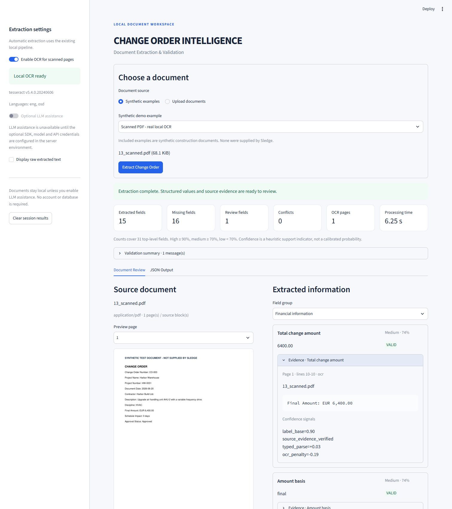

# Phase 2: operational OCR and local demonstration

This enhances the existing project. Extraction patterns, normalization, Pydantic schemas, financial validation, confidence formula, reconciliation, provenance, pipeline orchestration and CLI/batch interfaces are preserved. Original test files and original document fixtures are unchanged; their bytes are checked against the saved Phase 1 archive. [FILE_MANIFEST.txt](FILE_MANIFEST.txt) lists the complete submission and [examples/phase2-verification.json](examples/phase2-verification.json) records the exact new/modified-file inventory.

## Tesseract activation and actual result

Winget was installed outside the current shell's PATH. Its UB Mannheim package query found an existing **5.4.0.20240606** installation, so a fresh install/upgrade was unnecessary. The executable was verified at the conventional Program Files location, with **eng** and **osd** data. The user's PATH and `TESSERACT_CMD` configuration were updated. Portable application code discovers the override, PATH and conventional environment-derived install directories; it contains no user-specific executable path. On a clean Windows computer:

```powershell
winget install --id UB-Mannheim.TesseractOCR --exact
tesseract --version
tesseract --list-langs
python -m pip install -e ".[ocr,ui]"
```

Use the [UB Mannheim installer](https://github.com/UB-Mannheim/tesseract/wiki) if Winget is unavailable; ensure English language data is selected. A system installer may request administrator approval. Tesseract's binary/language files are external prerequisites and are not bundled in the ZIP.

Genuine local recognition of `examples/ocr/13_scanned.pdf` recovered:

```text
CHANGE ORDER
Change Order Number: CO-003
Project Name: Harbor Warehouse
Project Number: HW-0031
Document Date: 2026-06-20
Contractor: Harbor Build Ltd.
Description: Upgrade air handling unit AHU-2 with a variable frequency drive.
Discipline: HVAC
Final Amount: EUR 6,400.00
Schedule Impact: 0 days
Approval Status: Approved
```

The result is **success**, with actual page-1 OCR provenance and a **6400.00** selected total supported by `Final Amount: EUR 6,400.00`. The total's heuristic confidence is **0.741**, versus **0.93** from native text. Tesseract's mean word score is **0.954**; this does not replace field confidence. See [actual validated JSON](examples/ocr/13_scanned.pdf.result.json) and [complete recovered text](examples/ocr/13_scanned.pdf.raw.txt).

The PDF reader continues to use native text on usable pages and performs OCR only for sparse pages or predominantly scanned pages with a sparse searchable header. The mixed fixture records `native` on page 1 and `ocr` on page 2; a genuine-engine test verifies only page 2 invokes recognition. PNG/JPEG images use the same recognizer and existing output contract. Preprocessing honors reliable EXIF orientation, converts to grayscale and stretches contrast without thresholding away decimals or fine lines. PDF rendering remains resolution-aware and bounded. Missing executables, rendering/recognition failure, timeout and empty OCR produce explicit issues; usable pages remain available.

## Streamlit application

From the repository root and its activated virtual environment:

```powershell
python -m pip install -e ".[ui,ocr]"
python -m streamlit run streamlit_app.py
```

Open **http://127.0.0.1:8501**. Select an example or upload PDF/TXT/PNG/JPEG, then press **Extract Change Order**. The app presents source preview, grouped typed fields, confidence bands, colored validation states, alternatives, exact evidence, missing/review counts, OCR origin and measured processing time. **JSON Output** provides the unchanged pipeline JSON, copy (hover over the code block) and download. Multiple uploads return independent results and a combined ZIP. Source text is optional.

Only the explicit extraction action calls `pipeline.extract` through a temporary-file adapter. UI reruns retain session-local results and do not re-extract. Inputs/options invalidate stale results. There is no shared document cache, account, database or background-job service. The only shared cache holds engine availability for 60 seconds. Upload limits, safe basenames, cleanup and independent failures are tested. Document values/evidence render as plain text/code rather than user-provided HTML. Application code does not log document contents. The server binds to localhost and telemetry is disabled. Optional configured LLM assistance is off by default and explicitly identifies provider transmission.



The screenshot was captured from the running app in a real Edge browser. Browser checks exercised genuine OCR, visible source/amount/evidence, schema-valid JSON download, clipboard equality, desktop layout, and vertically stacked mobile results without horizontal overflow. No external app requests occurred during that baseline session. [Browser verification](examples/ui-verification.json) records these observations.

## Executed verification

- **148 tests passed**, including all **118 unchanged original tests**. The new cases cover real scanned/noisy/mixed/image OCR, sparse native overlays, timeout, missing executable, unreadable/empty input, evidence/confidence, temporary-file cleanup, UI/CLI consistency, JSON/ZIP payloads, reruns and Streamlit upload/example display.
- **94.51% package statement coverage** (95% rounded). The root Streamlit script is separately exercised with AppTest and a real browser; it is outside this package-only coverage denominator.
- **Original benchmark: 372/372 top-level fields**, unchanged ground truth, field precision/recall/F1 1.000 and zero missing-field false positives.
- **Real OCR benchmark: 124/124 top-level fields**, across scanned PDF, mixed PDF, noisy PNG and JPEG. Mean measured pipeline time was **2.49 seconds** in the final recorded OCR run; timings vary with machine load. All four had zero whitespace-normalized word/character error against native source text. Both blank fixtures failed as expected. [OCR report](examples/ocr/evaluation.json) contains exact timings, scores, origins and hashes.
- **Native text and PDF work in a non-editable baseline installation without optional OCR/LLM/UI/test dependencies.** CLI/batch behavior is preserved.
- **Lint, formatting, schema/provenance and final archive integrity checks passed.** Generated mixed and blank PDF pages were rendered with Poppler and visually inspected; the blank page is intentionally a negative fixture.

Commands:

```powershell
python -m pip install -e ".[dev,llm,ocr,ui]"
python -m pytest -q
python scripts/evaluate_examples.py
python scripts/evaluate_ocr.py
python -m ruff check .
python -m ruff format --check .
```

Real OCR tests have the `ocr` marker and explicitly skip when the binary/English data is unavailable. AppTest cases skip if Streamlit is absent. No paid service or live LLM is required. The optional browser check requires Playwright and a running local server:

```powershell
python -m pip install playwright
python scripts/verify_demo_browser.py
```

That script defaults to installed Edge; for bundled Chromium, install it with `python -m playwright install chromium` and pass `--browser-channel chromium`. The configured remote CI matrix has not been executed here.

## Changes and boundaries

New application files: `streamlit_app.py`, `.streamlit/config.toml`, `src/changeorder/ocr.py`, `src/changeorder/demo.py`, `tests/test_ocr_real.py`, `tests/test_demo.py`, and `tests/test_streamlit_app.py`. New scripts build OCR fixtures, measure actual recognition and verify the browser. New artifacts include the mixed/noisy/JPEG/blank fixtures, actual OCR JSON/text/results, screenshot and Phase 2 verification record.

Existing code changes are concentrated in `readers.py` for discovery/preprocessing/image support and recoverable page-render failures, `pyproject.toml` for the optional UI extra/test marker, packaging/audit scripts for the new artifacts, and CI for optional UI testing. README, approach, schema documentation and delivery notes describe the enhancement. The machine-readable schema and confidence/extraction/validation algorithms remain unchanged. The complete exact change list is in the verification JSON; the original archive is retained beside the project as `sledge-change-order-extractor-phase1.zip`.

## Remaining limitations

The four OCR examples are related synthetic representations of **one source document**; perfect results are not evidence of production accuracy or score calibration. Low-resolution/handwritten/rotated pages, complex table reading order, ambiguous revisions and semantically wrong but verbatim LLM candidates still require review. EXIF rotation is supported; untagged arbitrary rotations are not automatically guessed. Sparse-layer detection is heuristic and can miss image content when a large native text layer obscures it. No bounding-box highlights are implied. Live LLM quality remains unmeasured. OCR language defaults to English, and the system binary must be installed separately on other computers.

The final ZIP is `../sledge-change-order-extractor.zip`; environments, caches, build output, binaries and credentials are excluded. No remote repository was published and no submission message was sent.
