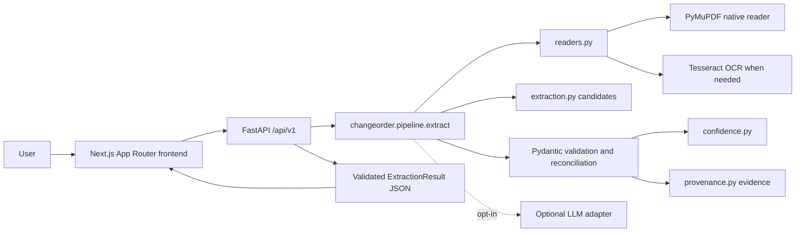
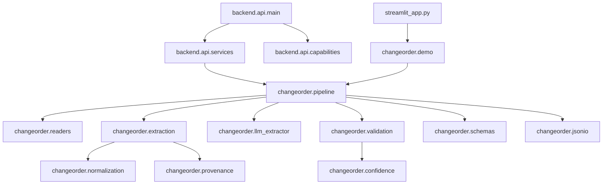
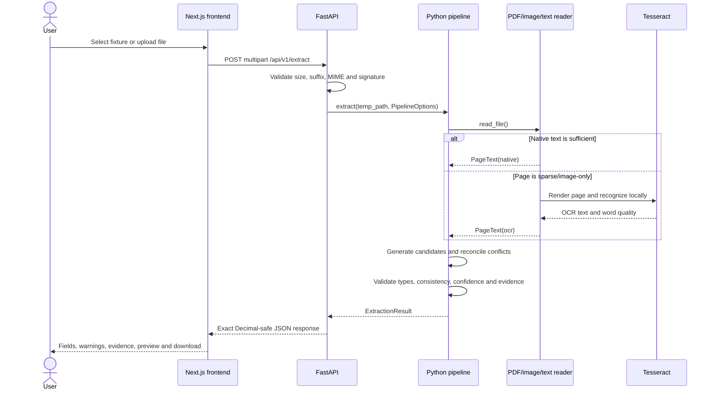
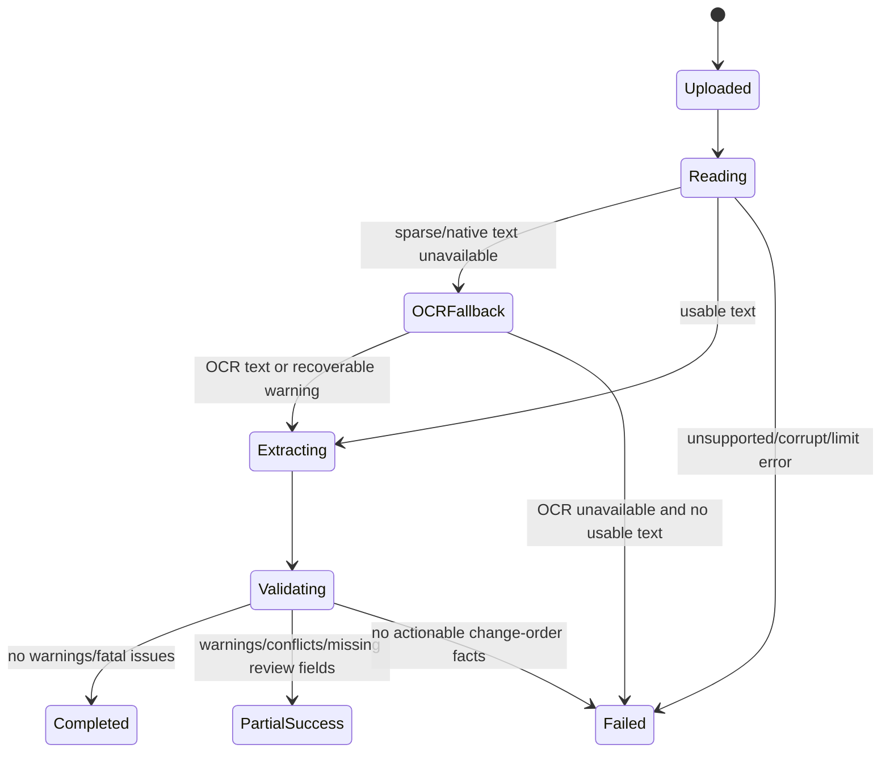
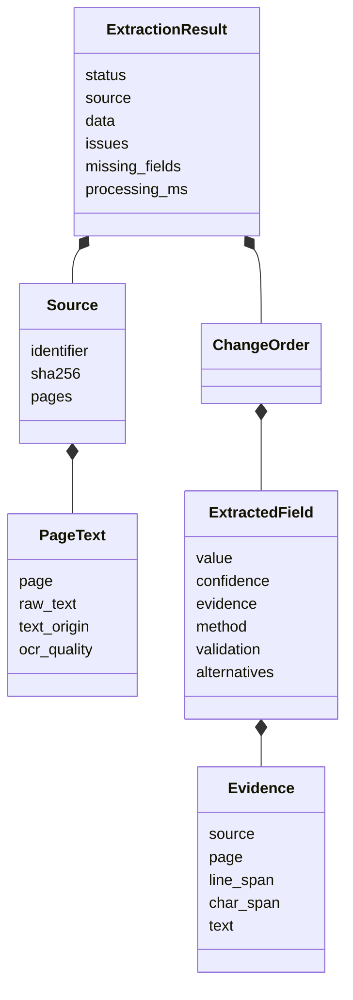
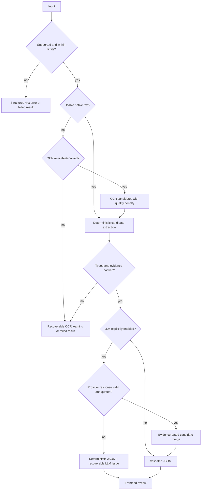
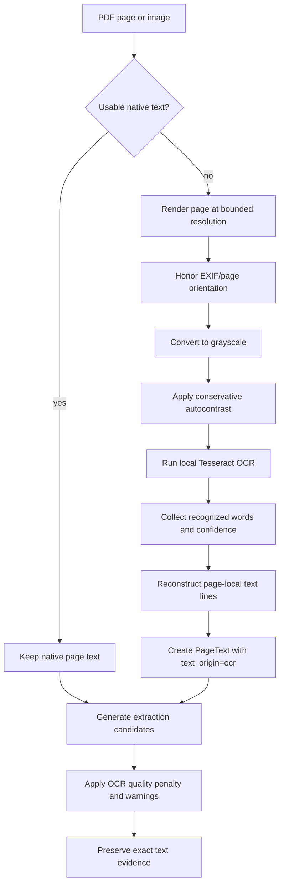

# Change Order Intelligence

Evidence-grounded construction document extraction for messy change-order PDFs, text files and images.

## Table of contents

- [Visual overview](#visual-overview)
- [1. Overview](#1-overview)
- [2. Original problem statement](#2-original-problem-statement)
- [3. Solution summary](#3-solution-summary)
- [4. Features](#4-features)
- [5. Architecture](#5-architecture)
- [6. Technology stack](#6-technology-stack)
- [7. Repository structure](#7-repository-structure)
- [8. Prerequisites](#8-prerequisites)
- [9. Installation](#9-installation)
- [10. Running the application](#10-running-the-application)
- [11. Application screenshots](#11-application-screenshots)
- [12. API reference](#12-api-reference)
- [13. Extraction pipeline](#13-extraction-pipeline)
- [14. OCR](#14-ocr)
- [15. Confidence scores](#15-confidence-scores)
- [16. Evidence and provenance](#16-evidence-and-provenance)
- [17. JSON output](#17-json-output)
- [18. Dataset and evaluation](#18-dataset-and-evaluation)
- [19. Testing](#19-testing)
- [20. Scripts and utilities](#20-scripts-and-utilities)
- [21. Codebase walkthrough](#21-codebase-walkthrough)
- [22. Security and compliance](#22-security-and-compliance)
- [23. Failure modes and limitations](#23-failure-modes-and-limitations)
- [24. Future improvements](#24-future-improvements)
- [25. Reproducibility](#25-reproducibility)
- [26. License and data attribution](#26-license-and-data-attribution)
- [27. Assessment deliverables](#27-assessment-deliverables)

## Visual overview

These screenshots are captured from the working application using the included synthetic fixtures. They are placed near the top so reviewers can see the product before reading the implementation details.

### Next.js + FastAPI workspace


### Streamlit demonstration


## 1. Overview

This repository implements the Sledge change-order extraction assessment. It turns a document into validated structured JSON with per-field confidence, exact supporting evidence, source pages, validation status, conflict alternatives and explicit missing values.

The stable Python extraction engine is used by the CLI, the legacy Streamlit demonstration, the FastAPI backend and the new Next.js workspace.

## 2. Original problem statement

> “Build a change-order extraction pipeline that turns messy change-order PDFs or text into validated JSON with per-field confidence scores. Include a short write-up of your approach and its failure modes. Please send a link to your code and write-up.”

This repository is a recruitment-assessment implementation of that requirement. `APPROACH.md` is the short technical write-up; detailed implementation notes are in `docs/`.

## 3. Solution summary

The system reads native text when available and falls back to local Tesseract OCR for sparse or image-only pages. It generates candidates from anchored labels, form headings and simple tables, parses values conservatively, reconciles competing candidates, checks cross-field consistency and returns the original source evidence for every accepted value. Optional provider assistance is off by default and cannot introduce values without verbatim source evidence and local parsing support.

## 4. Features

- PDF, UTF-8 TXT, PNG and JPEG ingestion.
- Page-aware native PDF reading and genuine local Tesseract OCR.
- Decimal-safe financial values and conservative date handling.
- Separate requested, proposed, approved, final, previous and revised contract roles.
- Per-field confidence, method, validation status, signals and alternatives.
- Exact line and character evidence spans with page references.
- FastAPI health, capabilities, single-document and batch endpoints.
- Responsive Next.js App Router workspace with upload, preview, evidence, warnings, JSON copy/download and batch review.
- Existing CLI and Streamlit demo remain available.
- Synthetic development fixtures, OCR fixtures and a rights-aware external-source research record.

## 5. Architecture

The browser is a presentation layer over a thin FastAPI transport. The Python package remains the single source of truth for document ingestion, OCR, extraction, validation, confidence, provenance and serialization.

### 5.1 High-level system architecture



The API does not create a competing field schema. It validates transport options, invokes the existing pipeline and returns the package response.

### 5.2 Component dependencies



### 5.3 Extraction request sequence



The LLM branch is opt-in and evidence-gated; a provider failure falls back to deterministic candidates.

### 5.4 Document data flow


Source spans are created from the actual page-local text; coordinates are not invented.

### 5.5 Processing states



The API reports the completed `ExtractionResult` status rather than fabricated percentage progress. The frontend shows upload, processing, complete and failed transport states.

### 5.6 Core models and module relationships



The implementation types are Pydantic models in [`src/changeorder/schemas.py`](src/changeorder/schemas.py); the diagram shows the important relationships without duplicating every field.

### 5.7 Failure and fallback flow



All failure paths preserve the distinction between unsupported input, recoverable processing warnings and fatal absence of actionable change-order facts.

See [`docs/ARCHITECTURE.md`](docs/ARCHITECTURE.md) for the standalone architecture reference.

## 6. Technology stack

- Frontend: Next.js App Router, React, TypeScript, Tailwind CSS, Lucide icons and Vitest.
- Backend: FastAPI, Pydantic, Uvicorn and HTTPX TestClient.
- Extraction: Python package under `src/changeorder`, PyMuPDF, Decimal and simplejson.
- OCR: local Tesseract through pytesseract and Pillow; no network OCR is used.
- Optional AI: existing structured OpenAI Responses adapter, explicitly opt-in.
- Quality: pytest, pytest-cov, Ruff, Bandit, npm audit and Playwright browser verification.

## 7. Repository structure

```text
sledge-change-order-extractor/
├── backend/api/                 FastAPI transport and capability detection
├── backend/tests/               API integration tests
├── frontend/src/app/            Next.js workspace UI and global styles
├── frontend/src/lib/            Typed API client and UI formatting helpers
├── src/changeorder/             Canonical extraction engine
├── tests/                       Existing engine, OCR, CLI and Streamlit tests
├── examples/                    Synthetic and OCR fixtures/results
├── benchmarks/                  External source metadata, labels and results
├── scripts/                     Evaluation, packaging and browser utilities
├── docs/                        Audit, architecture, compliance and verification docs
├── APPROACH.md                  Short assessment write-up
├── TODO.md                      Evidence-backed engineering checklist
└── pyproject.toml               Python package, extras and test configuration
```

## 8. Prerequisites

- Python 3.11 or newer.
- Node.js 20.9 or newer and npm; the current environment uses Node 22.
- Tesseract 5 with English language data for OCR/image processing.
- A modern browser for manual use. Playwright/Edge is used by the automated browser script when available.

## 9. Installation

### Windows PowerShell

```powershell
cd "E:\Remote Job  Task\sledge-change-order-extractor"
py -3.11 -m venv .venv
.\.venv\Scripts\Activate.ps1
python -m pip install --upgrade pip
python -m pip install -e ".[api,dev,ocr]"
cd frontend
npm install
cd ..
```

Set `TESSERACT_CMD` if Tesseract is not on `PATH`. Copy `.env.example` to a private `.env` only when local environment configuration is needed. The frontend reads `frontend/.env.local` or `NEXT_PUBLIC_API_BASE_URL`; never commit credentials.

### macOS/Linux

```bash
python3.11 -m venv .venv
source .venv/bin/activate
python -m pip install -e '.[api,dev,ocr]'
(cd frontend && npm install)
```

Install Tesseract with the platform package manager and confirm `tesseract --list-langs` includes `eng`.

## 10. Running the application

Start the backend from the repository root:

```powershell
\.venv\Scripts\python.exe -m uvicorn backend.api.main:app --host 127.0.0.1 --port 8000
```

In a second terminal, start the frontend:

```powershell
cd frontend
npm run dev -- --hostname 127.0.0.1 --port 3000
```

Open `http://127.0.0.1:3000`. FastAPI’s interactive OpenAPI page is at `http://127.0.0.1:8000/docs`.

Existing interfaces:

```powershell
# CLI single file
\.venv\Scripts\python.exe -m changeorder examples\documents\03_digital.pdf --output tmp\result.json

# CLI batch
\.venv\Scripts\python.exe -m changeorder --input-dir examples\documents --output-dir tmp\cli-batch

# Legacy Streamlit demo
\.venv\Scripts\python.exe -m streamlit run streamlit_app.py
```

## 11. Application screenshots

The screenshots are shown in the [visual overview](#visual-overview) near the top of this README. The source files are [`docs/images/nextjs-demo.png`](docs/images/nextjs-demo.png) and [`docs/images/streamlit-demo.png`](docs/images/streamlit-demo.png).

## 12. API reference

The detailed contract is in [`docs/API.md`](docs/API.md). Endpoints are:

- `GET /api/v1/health` — backend availability and pipeline version.
- `GET /api/v1/capabilities` — supported formats, limits and genuinely detected OCR/LLM capabilities.
- `POST /api/v1/extract` — one multipart document plus `ocr`, `llm` and `date_order` options.
- `POST /api/v1/batch` — repeated `files` multipart fields with independent `ExtractionResult` values.

Example:

```powershell
curl.exe -X POST http://127.0.0.1:8000/api/v1/extract `
  -F "file=@examples/documents/03_digital.pdf;type=application/pdf" `
  -F "ocr=off" -F "llm=false" -F "date_order=reject"
```

## 13. Extraction pipeline

1. `readers.py` enforces bytes/pages/characters/pixels and creates page-local `Source`/`PageText` records.
2. Native PDF text is preferred; sparse/image-only pages can use local OCR.
3. `extraction.py` recognizes anchored labels, form headings, inline fields and simple cost tables.
4. `normalization.py` parses Decimal money, dates, identifiers, statuses and schedule units without inventing defaults.
5. `validation.py` reconciles candidates, preserves alternatives and checks totals, line extensions, currencies and date order.
6. `confidence.py` computes an explainable heuristic support score.
7. `provenance.py` maps accepted candidates to exact line/character spans.
8. `jsonio.py` emits the validated schema with exact Decimal JSON numbers.

## 14. OCR

OCR is local, optional and detected at runtime. Native PDF text is always preferred when it is usable. OCR is used for sparse native pages, image-only PDFs and image inputs.

### 14.1 OCR processing flow



### 14.2 What happens in practice

1. The reader bounds file size, page count, rendered pixels and extracted characters before processing.
2. Each PDF page first tries PyMuPDF native text extraction. This preserves selectable text and avoids unnecessary OCR noise.
3. When native text is empty or too sparse, the page is rendered locally and passed to Tesseract; no network OCR service is required.
4. The image is oriented, converted to grayscale and given conservative contrast enhancement before recognition.
5. Tesseract words are grouped back into page-local lines, and the mean word confidence is stored on `PageText.ocr_quality`.
6. OCR text goes through the same candidate extraction, normalization, validation and provenance pipeline as native text.
7. OCR-derived values are marked with their origin and receive a quality penalty. Low-quality or unavailable OCR produces an explicit warning or failure rather than an empty success.

This design lets reviewers see whether a field came from native text or OCR and inspect the exact supporting snippet returned by the pipeline.

## 15. Confidence scores

Scores combine method strength, typed parsing, independent-method agreement, OCR quality, normalization warnings and conflict penalties. The UI uses High `>= 0.80`, Medium `>= 0.60`, Low `< 0.60`, with separate Missing and Conflicting labels. These are heuristic support indicators, not calibrated probabilities; the current data does not justify calibration claims.

## 16. Evidence and provenance

Every non-null field must carry evidence in the Pydantic model. Evidence includes source identifier, page when available, physical line span, character span, exact text and text origin. The frontend shows the returned snippet and page; it does not draw invented bounding boxes.

## 17. JSON output

The output contract is defined in [`src/changeorder/schemas.py`](src/changeorder/schemas.py) and exported at [`schema/extraction-result.schema.json`](schema/extraction-result.schema.json). A verified example is [`examples/outputs/03_digital.pdf.json`](examples/outputs/03_digital.pdf.json). The frontend download is the same validated response returned by the API, with timing naturally measured at the request boundary.

## 18. Dataset and evaluation

The 12 synthetic documents and four related OCR representations are development fixtures. They are not real-world accuracy evidence. The external-source research is in [`benchmarks/sources.csv`](benchmarks/sources.csv). One City of Fresno public change order is currently evaluated locally as development data with manually reviewed labels; because it informed a generalized fix, it is not held out. The PDF is not redistributed. See [`benchmarks/README.md`](benchmarks/README.md) for limitations and reproduction.

Latest measured runs in this workspace:

- Synthetic: 372/372 annotated field comparisons; 1.0 field exact match, with the script’s documented synthetic limitations.
- Related local OCR experiment: 124/124 comparisons across four fixtures and two negative cases; not independent real-world forms.
- External development document: 9/9 manually annotated fields matched; one native digitally generated document, partial status, not held-out and not a production accuracy estimate.

## 19. Testing

```powershell
# Python engine + API
\.venv\Scripts\python.exe -m pytest -q
\.venv\Scripts\python.exe -m pytest -q --cov=src/changeorder --cov=backend/api --cov-report=term-missing
\.venv\Scripts\python.exe -m ruff check src backend tests scripts streamlit_app.py

# Frontend
cd frontend
npm run typecheck
npm run lint
npm test
npm run build
cd ..

# Evaluations
\.venv\Scripts\python.exe scripts\evaluate_examples.py
\.venv\Scripts\python.exe scripts\evaluate_ocr.py
\.venv\Scripts\python.exe scripts\evaluate_real_documents.py --documents-dir tmp\real-research

# Real browser (start both services first)
\.venv\Scripts\python.exe scripts\verify_frontend_browser.py
```

## 20. Scripts and utilities

- `scripts/evaluate_examples.py`: evaluates 12 synthetic development documents against manually authored labels; writes `examples/evaluation.json`.
- `scripts/evaluate_ocr.py`: runs genuine local OCR over the existing OCR fixtures and writes per-case results; requires Tesseract English.
- `scripts/evaluate_real_documents.py`: evaluates only manually reviewed external labels from `benchmarks/ground_truth`; requires local source files and writes a reproducible report.
- `scripts/verify_frontend_browser.py`: Playwright/Edge verification of the running Next.js frontend, real API extraction, JSON download schema and mobile overflow; writes a genuine screenshot and report.
- `scripts/verify_demo_browser.py`: existing Streamlit browser verification.
- `scripts/audit_submission.py`: verifies source evidence spans in generated outputs.
- `scripts/package_submission.py`: writes `FILE_MANIFEST.txt`, creates a clean ZIP and verifies archive integrity.
- `scripts/run_examples.py`: generates CLI outputs for included examples.
- `scripts/build_pdf_examples.py` and `scripts/build_ocr_examples.py`: rebuild synthetic fixtures only.
- `scripts/export_schema.py`: exports the Pydantic JSON schema.

## 21. Codebase walkthrough

- `src/changeorder/schemas.py`: canonical Pydantic models consumed and produced by every interface.
- `src/changeorder/readers.py`: bounded file and page ingestion, PDF metadata, native text and OCR fallback.
- `src/changeorder/extraction.py`: anchored candidate generation and simple table/form layout handling.
- `src/changeorder/normalization.py`: typed parsing and conservative normalization rules.
- `src/changeorder/validation.py`: candidate reconciliation, conflict alternatives and cross-field consistency.
- `src/changeorder/confidence.py`: deterministic heuristic score and signals.
- `src/changeorder/provenance.py`: exact evidence span mapping.
- `src/changeorder/pipeline.py`: single orchestration entry point and result status policy.
- `src/changeorder/llm_extractor.py`: optional strict structured provider adapter with evidence gating.
- `src/changeorder/cli.py` and `src/changeorder/demo.py`: CLI and upload/demo utilities.
- `backend/api/main.py`: HTTP routes, middleware, CORS and safe error responses.
- `backend/api/services.py`: filename/content validation, temporary files and pipeline invocation.
- `frontend/src/app/page.tsx`: accessible upload/review workspace; all values come from typed API responses.
- `frontend/src/lib/api.ts`: centralized API client and multipart options.
- `frontend/src/lib/format.ts`: field groups, confidence bands and display/download helpers.

Related tests are named by boundary: `test_readers.py`, `test_extraction.py`, `test_validation.py`, `test_ocr_real.py`, `test_cli.py`, `test_streamlit_app.py`, `test_public_form_layouts.py` and `backend/tests/test_api.py`.

## 22. Security and compliance

See [`docs/COMPLIANCE.md`](docs/COMPLIANCE.md). The important unresolved items are a successful online `pip-audit` run and the full npm development-tree findings. Production npm audit was clean; Bandit found no high-severity issue in production Python/API code. PyMuPDF’s AGPL/commercial licensing decision and external-document redistribution rights require attention before public redistribution.

## 23. Failure modes and limitations

- Complex multi-column PDFs, unusual tables and labels split across visual columns may produce partial results.
- OCR quality depends on local Tesseract, page rendering and source scan quality.
- Amount roles are conservative; ambiguous totals remain conflicts or warnings instead of being calculated silently.
- Numeric dates are rejected by default when day/month order is ambiguous.
- Confidence is not calibrated probability.
- Provider assistance is optional, external and evidence-gated; local deterministic extraction works without it.
- Current external evaluation is one development document, not a held-out benchmark.
- No persistent job database or user authentication is included.

## 24. Future improvements

- Build a rights-cleared, diverse external corpus with independent held-out documents.
- Add layout-aware coordinates and table extraction after collecting representative failures.
- Calibrate confidence only after enough independently labeled data exists.
- Add process isolation for hard request timeouts if deployment threat modeling requires it.
- Refresh frontend development dependencies after reviewing the full npm audit tree.

## 25. Reproducibility

The project records baseline and final checks in [`docs/FINAL_VERIFICATION.md`](docs/FINAL_VERIFICATION.md), decisions in [`docs/DECISIONS.md`](docs/DECISIONS.md), and the active checklist in [`TODO.md`](TODO.md). Run the installation commands, start both services, run the test/evaluation commands above, and use the browser script against the local URLs. External documents are reproduced from the URLs and hashes in `benchmarks/sources.csv`, subject to their terms.

## 26. License and data attribution

No repository-wide license file was supplied in the original project, so this assessment implementation does not invent one. Add the employer’s intended repository license before public distribution. Python/JavaScript package obligations and the PyMuPDF AGPL/commercial choice are summarized in `docs/COMPLIANCE.md`. Synthetic fixtures are explicitly labeled as synthetic. External documents are attributed by source URL and are not bundled when redistribution rights are unclear.

## 27. Assessment deliverables

- Primary extraction requirement: existing Python engine preserved and independently verified.
- Short approach/failure-mode write-up: [`APPROACH.md`](APPROACH.md).
- Professional full-stack demonstration: `frontend/` plus `backend/`.
- Validated JSON schema/evidence: `src/changeorder/schemas.py`, `schema/` and `docs/API.md`.
- Architecture and technical diagrams: [`docs/ARCHITECTURE.md`](docs/ARCHITECTURE.md).
- Baseline, decisions, compliance and verification: `docs/BASELINE_AUDIT.md`, `docs/DECISIONS.md`, `docs/COMPLIANCE.md`, `docs/FINAL_VERIFICATION.md`.
- External research and honest evaluation limits: `benchmarks/`.
- No public deployment or GitHub publication was performed.
