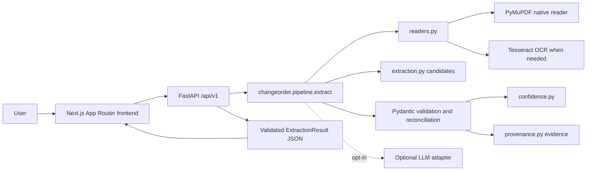
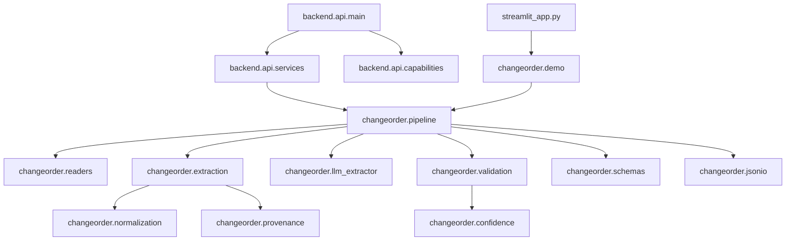
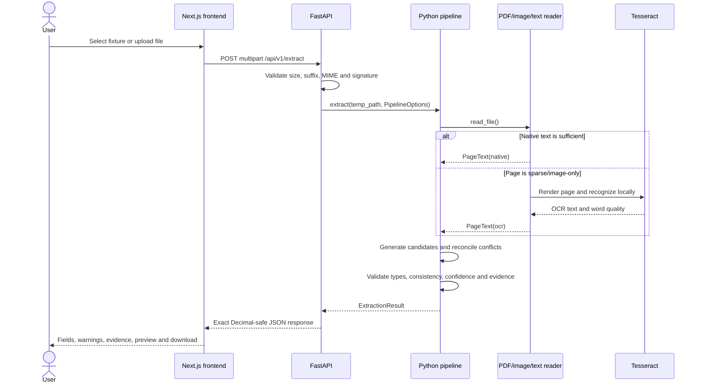
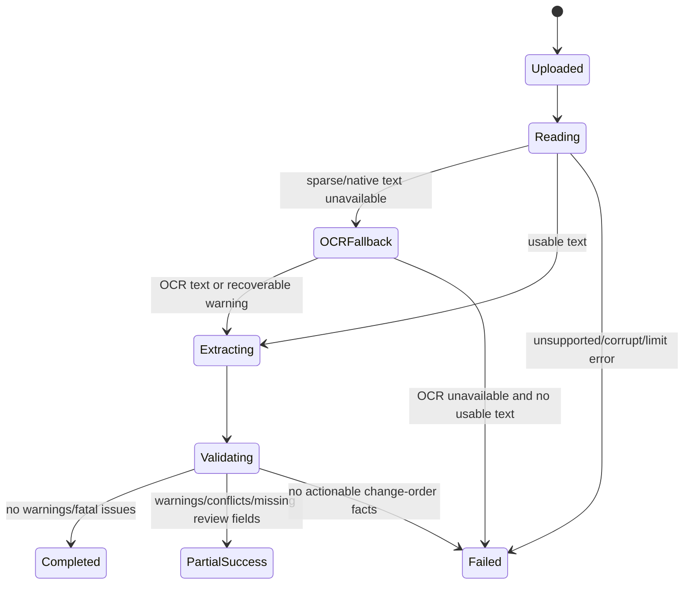
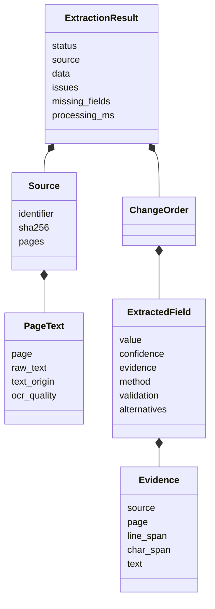
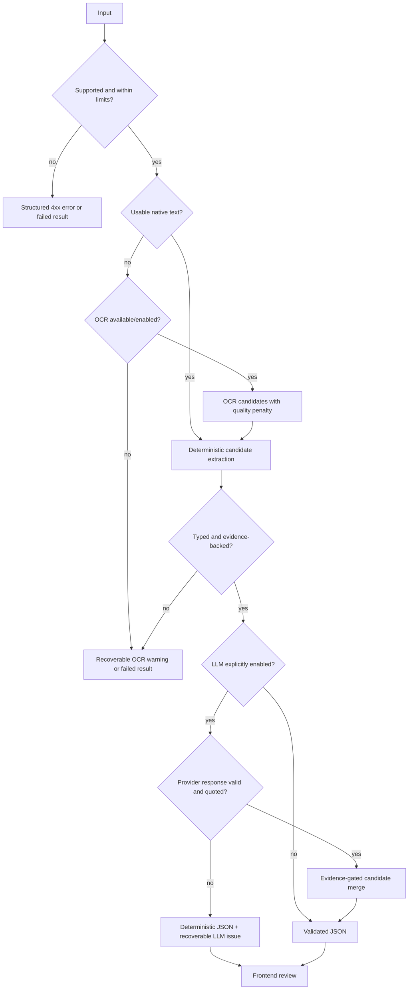

# Architecture

The browser is a presentation layer over a thin FastAPI transport. The Python package remains the single source of truth for document ingestion, OCR, extraction, validation, confidence, provenance and serialization.

## 1. High-level system architecture

The API does not create a competing field schema. It validates transport options, invokes the existing pipeline and returns the package response.

## 2. Component dependencies

## 3. Extraction request sequence

The LLM branch is opt-in and evidence-gated; a provider failure falls back to deterministic candidates.

## 4. Document data flow

Source spans are created from the actual page-local text; coordinates are not invented.

## 5. Processing states

The API currently reports the completed `ExtractionResult` status rather than fabricated percentage progress. The frontend shows only upload, processing, complete and failed transport states.

## 6. Core models and module relationships

The implementation types are Pydantic models in `src/changeorder/schemas.py`; the diagram shows the important relationships without duplicating every field.

## 7. Failure and fallback flow

All failure paths preserve the distinction between unsupported input, recoverable processing warnings and fatal absence of actionable change-order facts.
